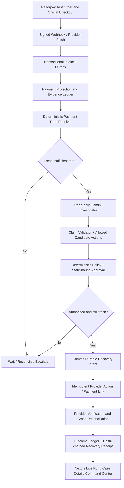

# ReclaimRail — Unified Master Development Roadmap

**Version:** 2.2 — 25 November 2026 submission-priority amendment
**Product:** Evidence-Grounded AI Payment Truth & Revenue Recovery Control Plane
**Context:** Razorpay AI Buildathon · Track 03 — AI Revenue Recovery
**GitHub:** https://github.com/dhanushgowdars/ReclaimRail
**Status of this document:** `LOCKED — OWNER APPROVED 18 NOVEMBER 2026`. Changes require an append-only decision record and explicit owner approval; promised F-01–F-50 scope may not be silently removed.
**Grounding:** Previous project reports, local terminal output, locked Phases 14–23 plan and the 50-feature catalogue supplied on 17 November. This is **not a new audit or a claim that any untested feature works**.

### Document authority

This blueprint consolidates product scope and priority. It does not replace the six
repository-state and implementation-control documents:

1. `AGENTS.md` controls how work is performed.
2. `CURRENT-STATE.md` controls evidence-backed product status.
3. `MASTER-EXECUTION-PLAN.md` controls gate order and the active work order.
4. `DECISIONS.md` controls locked decisions and owner choices.
5. `ACCEPTANCE-MATRIX.md` controls requirement-level completion.
6. `WORK-LOG.md` preserves commands, failures and evidence history.

When this blueprint conflicts with those files, the six audit documents win until an
explicit owner-approved reconciliation updates them. The M0–M8 milestones below are
priority and feature-crosswalk views; they do not renumber or reorder the established
Gate 1A → Gate 2 → Phase 17B → Phase 18 → Phase 19 → Phase 20 → Phase 21 → Phase 22 →
Phase 23 execution sequence.

---

## 0. Executive decision

Complete **ReclaimRail**, do not rebuild it. Use the existing FastAPI/PostgreSQL/Redis/Next.js/Razorpay foundation. Retain the original Phase 14–23 architecture roadmap; ingest the F-01–F-50 catalogue as requirement IDs and acceptance criteria; advance only through the controlled audit and implementation gates. One provider-backed failure-to-recovery journey plus audited safe-stop cases is more valuable than a large inventory of half-verified features.

### Three distinct planning layers

1. **Repository audit gates** are the authority on what can begin and what must pass. Gate 1A and Gate 2 are closed; Phase 17B remains `PARTIAL`. `DEC-032` permits bounded deterministic Phase 18 work without closing Phase 17B.
2. **Original functional Phases 14–23** are the architectural dependency map. The previously built Phases 1–13 remain the foundation.
3. **Feature IDs F-01–F-50** are a complete target inventory; they are not 50 new phases, nor evidence of missing code.

**Status discipline:** `VERIFIED` (implementation + passing evidence), `PARTIAL` (works incompletely or incomplete evidence), `BROKEN` (reproduced failure), `NOT IMPLEMENTED` (absence confirmed), `OBSOLETE` (superseded), and `NEEDS INSPECTION` (current evidence is insufficient). A previously completed phase may contain a newly identified gap; record both facts.

### Evidence hierarchy

Actual current local branch and diff → current local audit documents → reproduced tests/runtime/provider evidence → historical test reports → old roadmap/readme → assumptions. If evidence conflicts, do not silently select a convenient result. Investigate and record the discrepancy.

### Verified-as-reported snapshot, not current runtime assertion

| Item | Last recorded evidence (18 Nov 2026) |
|---|---|
| Active working copy | `D:\NEW VOLUME\INTERNSHIP PREP\RAZORPAY\ReclaimRail-Audit-Reset` |
| Branch | `audit/current-state-reset` |
| HEAD in most recent report | `8703bfbd9a3b36dcf4a1af74a1bb04ea76311f5d` |
| Reported diff | Exact 18 November inventory: **22 unstaged paths** — 16 application/test/frontend paths and 6 audit documents. The additional path is `apps/web/src/app/globals.css`; its 15-line/4-line responsive Safety Controls and navigation correction was reviewed and `git diff --check` passed. |
| Commits / push for Gate 1A | Owner-authorized local 23-path closure commit; no push |
| Infrastructure / migration | PostgreSQL and Redis healthy; Alembic revision `f8c1b2d3e4a5` installed; autogeneration check clean in recorded run |
| Static validation | Formatting, Ruff, mypy passed (recorded run) |
| Focused integration run | Historical failing snapshot was superseded: an intermediate run reported 21 passed/1 failed; the corrected focused run reported **22 passed**. |
| Complete backend run | **698 passed, 1 skipped**; the known execution-counter race remains the recorded skip. |
| Fresh frontend revalidation | ESLint exit 0; Next.js 16.3.5 production build exit 0; TypeScript and all application routes compiled; diff check exit 0; staged count 0; changed count 22. |
| Fresh full-controller reproduction | Database `reclaimrail_gate1a_controller_20261118152748` migrated from base to `f8c1b2d3e4a5`; isolated Redis database 14; all 11 processes running; API ready; 8/8 workers healthy; no Gemini or Razorpay mutation authorized. |
| Gate 1A | **VERIFIED** and closed by the owner-authorized local commit |
| Full end-to-end payment recovery | No newer provider-backed full-run proof supplied |

The proposal originally cited two failures:

- `test_unavailable_provider_is_not_called_again_inside_persisted_cooldown` — expected second call count 0, observed 1.
- `test_fresh_provider_evidence_recovers_after_unavailable_evidence_expires` — expected new projection after recovery, observed unchanged.

That snapshot is obsolete as current Gate 1A status evidence. Repository work-log evidence
records a later provider-event correction, `22 passed`, and the complete `698 passed,
1 skipped` run. The exact 22-path worktree is reconciled, its frontend compiles cleanly,
the full tracked controller passes on a fresh database, and final 1024/1440/1920 plus
populated-case evidence was manually inspected. The authority documents were finalized,
the roadmap locked and the exact 23-path local closure commit authorized. Gate 1A is
`VERIFIED`; the statement that Gate 2 was next is historical. See the 25 November amendment below for current priority.

### 25 November 2026 — submission-critical vertical slice

Owner decision `DEC-041` changes delivery priority, not the Gate 1A → Gate 2 → Phase
17B → Phase 18 → Phase 19 → Phase 20 → Phase 21 → Phase 22 → Phase 23 gate numbering,
past evidence, or F-01–F-50 scope. Phase 17B is `PARTIAL`; later phases are not
completed by this amendment. First demonstrate (1) one genuine Razorpay Test Mode
failed payment through a provider-confirmed, exactly-once attributed paid Payment Link
and (2) one separate unsafe/uncertain case that policy blocks without mutation.

| Order | Submission work | Backend proof and merchant-facing state |
| --- | --- | --- |
| 1 | Truth and case | Provider-emitted signed webhook or verified fetch, source/provenance, failed truth version and eligible case; Command Center and Recovery Cases show the same stored evidence. `UNKNOWN` never becomes `FAILED` from a timeout. |
| 2 | Investigation and validation | Bounded read-only transcript, citations, same-case/cutoff/freshness/value/contradiction verdicts, abstention or fallback; Investigation Room displays accepted/rejected claims and source IDs. Live model selection still needs its locked Phase 17B gate. |
| 3 | Policy and review | Feasible coordinate-free intent, deterministic reason codes and hard stops; if required, Human Reviews shows approval bound to case/truth/evidence/action/backend amount and expiry, plus stale invalidation. |
| 4 | Durable link and payment | Committed intent, lease, idempotency key, provider request/response and ambiguity reconciliation before retry; backend supplies the official Payment Link. Investigation Room shows pending/verified action separately from payment. |
| 5 | Attributed outcome | Provider-confirmed paid link and payment linked to that intent/case, exactly one attributed Test Mode outcome; Outcome Ledger and Command Center show pending vs recovered, with reload proof. |
| 6 | Safe block | Captured, unknown, conflicting, stale, consent-denied or otherwise prohibited case; no intent/provider mutation; persisted reason visible in Recovery Cases, Investigation Room and Human Reviews where applicable. |

Minimum demo pages are **Command Center, Recovery Cases, Investigation Room, Human
Reviews and Outcome Ledger**. Each needs persisted backend read models, loading/empty/
error/uncertain states, Test Mode provenance, protected actions, refresh persistence and
visually inspected browser evidence. A successful build alone proves no page complete.

Proposed improvements, pending implementation and provider/account evidence:

- **Cause-specific AI diagnosis — P1 enhancement (DEMO-09):** depends on provider-backed
  failure-field provenance and Phase 18 same-case validation, with Phase 22 display.
  Every asserted cause must cite verified provider fields owned by the case and available
  at the evidence cutoff. Missing, unsupported or ambiguous fields yield `UNKNOWN` or
  abstention. Test only failure causes actually evidenced by the Test Mode account;
  no diagnosis establishes payment truth. Core claim validation remains SC.
- **Cause-sensitive feasible strategy — P1 enhancement (DEMO-10):** depends on two
  distinct verified causes from DEMO-09, Phase 18 feasible intents and Phase 19 policy.
  Under the same cutoff and policy, two supported causes must produce meaningfully
  different feasible intent sets or selected intents when policy allows; unsupported
  cause text cannot force a different action. Record exclusions and explain them in
  Phase 22. AI cannot set amount, contact, provider ID or link URL; the backend resolves
  them. Core feasible-intent safety remains SC; calibrated ranking (F-19) remains P1.
- **Optional prepared, unsent customer message — P1 (DEMO-11):** follows verified
  facts, consent/policy and Phase 20 backend link capability; preview in Phase 22 is
  never a dependency of core recovery. Deterministic checks reject facts outside the
  approved same-case evidence/cutoff, unsupported language, overlength drafts,
  credential/PIN/OTP requests, absent consent or missing provenance. Validate the
  draft before inserting an official Payment Link from trusted backend data; no
  model-provided URL or send side effect. Show `PREPARED_NOT_SENT` unless actual
  delivery is separately verified; absent link/consent shows a blocked reason.

Submission measurement first compares rule-only and AI-assisted investigation on a
small frozen set with identical evidence cutoffs, policy and case-level outputs. Report
truth/citation/abstention, unsafe/duplicate actions, availability and denominators;
an unsafe naive strategy may run in isolated simulation only. Simulated outcomes do
not count as provider-confirmed recovered money. Retain the full four-arm Scenario Lab,
Rail Intelligence, full Safety Controls, advanced ranking, receipt chain and receipt UI
in F-01–F-50 and Phases 18–23. The core tamper-evident receipt and verifier remain
mandatory under P21-07/08; deferring either would keep the release gate open and
requires a separate owner decision.

After one bounded **complete** model evaluation, report pass or failure against the
locked Phase 17B thresholds and stop. No further provider search, model additions or
prompt-tuning round without a separate owner decision. The latest local five-attempt
verification had no eligible chain and therefore no corpus; it is not a completed
model-quality evaluation.

---

## 1. Product definition, constraints, and audience

### One-line pitch

**ReclaimRail recovers eligible failed payments without guessing: it establishes payment truth, lets AI investigate evidence, lets deterministic policy authorize safe interventions, and proves the final provider-backed result.**

### User personas

- **Merchant operator:** see which cases risk revenue, what is happening, and which decisions require attention.
- **Approver:** review evidence and safely approve/reject exactly one version-bound action.
- **Reviewer/judge:** create one real Test Mode failure and trace the entire verified recovery process within a guided workflow.
- **Developer/maintainer:** reproduce scenarios, inspect worker health, migrations, audit and evaluation evidence.

### Core product promises

1. *Truth first:* `UNKNOWN` is not `FAILED`. Browser callbacks and stale payment signals never authorize collection by themselves.
2. *AI is advisory:* bounded read-only tools, citations and explicit abstention; no money-moving tool access.
3. *Financial authority is deterministic:* fresh payment evidence, policy, locks and version-bound approval must precede mutations.
4. *Actions are durable and idempotent:* provider ambiguity results in reconciliation, not a blind second API call.
5. *Outcomes are proven:* action success, link payment and attributed recovery are distinct states.
6. *Demo honesty:* real Razorpay Test Mode evidence is labelled Test Mode; synthetic lab results are isolated and labelled simulation.
7. *Reviewability:* a judge can inspect the reasoning and outcome without reading the whole source tree.

### Explicit non-goals until selection-critical work is verified

No live-money mode, multi-provider architecture, custom credential collection, voice calls, subscription recovery, self-trained LLM, multiple interacting agents, vector database, mobile app, separate marketing site, or production-revenue claims. Advanced rail models, decorative dashboards and additional languages are stretch work only.

---

## 2. Target end-to-end architecture



### Technology boundaries

- **Next.js 16 / React 19 / TypeScript / Tailwind:** reviewer experience, state visualization and protected operator workflows; no financial truth is derived from client state.
- **FastAPI / Pydantic / Python:** HTTP contracts, orchestration, validation, policy and read models.
- **PostgreSQL / SQLAlchemy / Alembic:** authoritative event, evidence, payment truth, case, intent, approval and outcome persistence.
- **Redis streams and workers:** asynchronous execution; transactional outbox protects work when Redis is unavailable.
- **Gemini adapter:** configurable model, constrained read-only tools, structured claims; operational failures fall back safely.
- **Razorpay Test Mode:** provider-sourced order/payment/link status, signed webhooks and actual Test Mode Checkout.
- **Dedicated test/simulation infrastructure:** never mixes synthetic receipts or fake webhook traffic with the provider-verified merchant dashboard.

### Minimum contracts to preserve or extend

`PaymentEvidence`, `PaymentTruthSnapshot`, `PaymentAttempt`, `RecoveryCase`, `InvestigationSession`, `Hypothesis`, `AIClaim`, `RecoveryIntent`, `PolicyDecision`, `ApprovalGrant`, `ProviderActionAttempt`, `RecoveryOutcome`, `RecoveryReceipt`, `PaymentLabRun`, and versioned `SafetyControl`.

A contract is accepted only when its persisted and serialized forms agree, its ownership/version rules are enforced, and tests exercise invalid combinations.

### Early Razorpay Test Mode capability gate

Before M4 implementation, record one account-specific, read-only capability report. It
must verify which Standard Checkout failure controls and payment methods are enabled for
the owner's Test Mode account, whether Standard Payment Links can be created/read/cancelled
within the account limits, and which webhook events can be delivered to the chosen HTTPS
endpoint. Until that report exists, these capabilities are `NEEDS INSPECTION` rather than
assumed from documentation.

Current documentation constraints to validate, not silently hardcode:

- Standard Checkout Test Mode uses mock success/failure flows and configured methods may
  depend on the account.
- Standard Payment Link `reference_id` is unique and duplicate creation returns an error,
  but that alone does not replace ReclaimRail's durable intent and reconciliation protocol.
- the documented Test Mode limit is 30 Payment Links per business;
- a Standard Payment Link must remain distinct from a UPI-only Payment Link; and
- webhook validation uses the raw request body, HMAC-SHA256 and duplicate-event handling
  based on `x-razorpay-event-id`; delivery order cannot be assumed.

Reference pages (recheck on the execution date):

- `https://razorpay.com/docs/server-integration/python/test-app/`
- `https://razorpay.com/docs/api/payments/payment-links/cancel-standard/?preferred-country=IN`
- `https://razorpay.com/docs/payments/payment-methods/upi/`
- Razorpay webhook validation/best-practice documentation for the active account product.

---

## 3. Non-negotiable financial and AI invariants

| ID | Invariant | Required negative test |
|---|---|---|
| INV-01 | `OUTCOME_UNKNOWN` never becomes `FAILED` without evidence | Provider timeout, missing webhook or conflicted sources cannot authorize recovery |
| INV-02 | AI cannot execute provider mutations or alter authoritative amounts | Malicious model output attempting provider call/amount override is rejected |
| INV-03 | Every accepted AI claim has same-case, timely, verified evidence | Cross-case, future, stale and invented evidence IDs fail validation |
| INV-04 | Provider-changing calls require a committed durable intent | Fail the DB commit and prove zero external mutation calls |
| INV-05 | Ambiguous provider results become `IN_FLIGHT` / reconciliation-required | Crash or timeout does not trigger a blind second request |
| INV-06 | Reconciliation precedes retry | Recovered provider action is discovered rather than recreated |
| INV-07 | Recovery actions are idempotent under concurrency and replay | Two workers / 100 duplicate webhooks produce one effective action |
| INV-08 | Approval is bound to case/truth version, evidence digest, action, amount and expiry | Late authorization invalidates approval before execution |
| INV-09 | New material evidence invalidates stale proposals, grants and intents | Updated truth prevents old proposed action from executing |
| INV-10 | Money is represented and computed in integer paise | Rounding, partial payment and sum invariants checked |
| INV-11 | Test, replay and simulation provenance are explicit and separated | Synthetic data cannot inflate provider-backed recovered metrics |
| INV-12 | Action creation, payment confirmation and attributed recovery are separate | Created link or message alone yields zero recovered amount |
| INV-13 | Prompt-injected/untrusted text cannot change policy, tool rights or system instructions | Injected webhook or customer text cannot authorize any blocked action |
| INV-14 | Insufficient evidence causes wait/escalation/abstention, not fabricated certainty | Provider outage + missing evidence gives no unsafe action |
| INV-15 | No real customer data or credentials are leaked in prompts, logs or browser | Redaction and secret scanning of error paths |
| INV-16 | Contact requires verified capability, consent and budget | Opt-out or cooldown blocks notification |
| INV-17 | Browser success callbacks are never accounting truth | Fake success callback leaves outcome unverified |
| INV-18 | Replayed historical proof is read-only | Replay creates no provider action and increments no metrics |

The zero-unsafe-action target is scoped to tested cases, not a claim of mathematical impossibility in every environment.

---

## 4. Delivery milestones (not replacement audit gate numbers)

### M0 — Close existing Gate 1A: payment-truth reconciliation controls

**Priority:** Blocker. **Dependencies:** existing Gate 0/1 baseline. **Source feature:** F-05 (plus F-04/F-03/F-47).
**Historical phase alignment:** Phases 15–16 hardening.

**Implementation/verification work and current status:**

1. Read local `AGENTS.md` and all five product audit docs. Inspect `git status`, branch, HEAD, diff and current migration before editing anything.
2. Preserve the known backup and verify local changes are not accidentally overwritten. Make an additional scoped backup before touching code.
3. **Done:** the 22nd path is `apps/web/src/app/globals.css`; preserve all 16 application/
   test/frontend paths and six existing audit-document paths.
4. Retain the verified containment correction: durable retry state, stable unavailable
   evidence identity, synthetic blocking and provider-event recovery behavior.
5. **Done:** correct only the recorded responsive navigation/table clipping and case-
   evidence washout within Gate 1A scope.
6. **Done:** re-run focused tests, the complete backend suite, migration/autogenerate checks, Ruff,
   mypy, frontend lint/build and the tracked 11-process readiness stack against a fresh
   isolated database.
7. **Done:** capture and manually inspect 1024/1440/1920 Safety Controls evidence and a
   populated same-case view; automated DOM presence alone was not used as completion proof.
8. **Deferred without deletion:** provider-emitted Test Mode evidence remains separate and
   mandatory for the later provider-backed journey; no provider mutation is part of Gate 1A.
9. Update the six audit documents with exact commands, revision, results and residual
   risks. Stage and commit only after owner-authorized review; no automatic push.

**Exit evidence:** exact preserved working-tree inventory; `0` focused failures; cooldown
respected across worker/database instances; safe recovery after cooldown; migration head
matches; all 11 tracked processes and 8/8 workers are healthy; responsive screenshots are
visually legible; no unreviewed unrelated diff; accepted local Gate 1A commit.

**Stop rule:** Do not start new Phase 17/18 implementation while M0 is unfinished.

### M1 — Establish trustworthy payment truth and case eligibility

**Priority:** P0. **Dependencies:** M0. **Feature IDs:** F-01–F-04, F-06–F-08, F-29. **Phases:** 14–16.

**Inspect and reuse:** raw-body HMAC, verified webhook intake, delivery ID deduplication, durable outbox, worker idempotency, payment projection, late-authorization safety and existing incident detection.

**Deliver only observed gaps:**

- Evidence ledger: immutable event/provider references; source, event time, observed time, verification status, payload digest and applicable case/payment ownership.
- Deterministic truth snapshots with version and evidence IDs: `PAYMENT_CONFIRMED`, `PAYMENT_FAILED`, `PAYMENT_PENDING`, `OUTCOME_UNKNOWN`, `SOURCE_CONFLICT`, `LATE_AUTHORIZATION`, `RECOVERY_ALREADY_ACTIVE`, `RECOVERY_CONFIRMED`, `MANUAL_INVESTIGATION_REQUIRED`.
- Failure taxonomy as a versioned mapping of Razorpay-supported failure evidence. Include `UNKNOWN`; never invent a provider error category; omit unused mandate/subscription-specific categories until in scope.
- Revenue-at-risk register with amount, age, proof status, attempts, deadline, active policy/consent constraints and non-hallucinated priority.
- Late authorization cancels *pending, cancellable* recovery attempts. Cancellation does not undo already-completed payments; those require explicit duplicate-payment handling and safe operational escalation.

**Acceptance:** shuffled/duplicate/delayed events cannot downgrade captured truth; absence of webhook remains uncertain; provider unavailable remains uncertain; a captured original payment stops further collection; case totals reconcile without double-counting; event ingestion replays do not change finalized proof.

### M2 — Close deterministic financial authority and durable execution

**Priority:** P0. **Dependencies:** M1. **Feature IDs:** F-18, F-20–F-29. **Phases:** 19–21, with existing foundation reused.

**Build or harden:** allowed action contract, reproducible policy reason codes, policy version, consent/quiet hours, attempt/contact limits, risk and incident holds, state-bound approval and re-evaluation immediately before action. Persist `PENDING` intent before provider request, lock per case, use a deterministic business key and provider lookup to resolve ambiguous outcomes. Support cancellation and compensation when safe.

**Approval safety:** although F-22 was labelled P1 by Claude, **stale-approval invalidation is P0**. The full approval UI can be polished later; the backend guarantee cannot.

**Provider link safety:** `reference_id`/search-before-create is not a universal substitute for provider-enforced idempotency. Validate exact Razorpay capabilities and implement durable reconciliation for ambiguous responses. A provider success followed by app crash must be treated as possible success until disproven.

**Acceptance:** `UNKNOWN`/already paid/opt-out/expired/held cases cannot create links; stale approval fails; concurrent workers yield one effective authorized action; network timeout and app crash reconcile before retry; all outcomes and stops carry evidence and reason codes.

### M3 — Finish and measure the Gemini evidence investigator

**Priority:** P0. **Dependencies:** M1, safe policy boundary from M2. **Feature IDs:** F-11–F-15, F-18, F-36; F-17 optional. **Phases:** 17–18.

**Reuse from earlier Phase 17:** read-only tools, bounded investigation session/step records, hypothesis ledger, model adapter, deterministic fallback and reviewable trace. Do not discard previously merged work merely because live Gemini verification was incomplete.

**Implementation tasks:**

1. Validate the candidate tool schemas and case scoping; forbid writes and unrestricted network access.
2. Run `Observe → Hypothesize → Fetch evidence → Challenge → Conclude/Abstain` with max rounds, wall-clock, tokens and tool calls.
3. Accept structured evidence-linked claims, recommendation and alternative only after schema validation.
4. Claim verifier performs ownership, availability-cutoff, freshness, field/value and contradiction checks against persisted evidence; rejects unsupported evidence IDs.
5. Compare different case families; tool paths should differ when evidence differs, without leaking baseline answers into prompts.
6. Test Gemini malformed JSON, quota, 429/503, timeout, slow tool, invalid tool name, prompt injection and no evidence; classify outcomes and fall back safely.
7. Complete live bounded benchmark under the actual available Gemini model; report exact model, input/output tokens, latency, success, abstention and failure counts. Do not infer current performance from September traces.

**Action ranking:** P0 delivers a safe *allowed action candidate set*. A learned/calibrated expected-net-recovery ranking is P1 and must be labelled `NOT_CALIBRATED` if meaningful labels are unavailable.

**Acceptance:** every displayed model claim is source-backed or visibly rejected; unsafe proposals cannot reach provider execution; deterministic fallback is transparent; measured cases exhibit genuinely different tool sequences; model outage never creates unauthorized recovery.

### M4 — Prove the complete real Razorpay Test Mode recovery journey

**Priority:** Submission-critical. **Dependencies:** M1–M3 safety and execution gates. **Feature IDs:** F-25–F-27, F-38, F-45, F-46. **Phases:** existing Payment Lab + 20 + 23.

**Guided reviewer flow:**

1. Protected Payment Lab creates a real Razorpay Test Mode Order *server-side*.
2. Official Razorpay Standard Checkout opens; use a currently supported account-specific Test Mode payment failure method. **Do not depend on manual UPI Collect/VPA entry**, as Razorpay documentation notes deprecation of many such flows effective 28 Feb 2026.
3. Persist `PaymentLabRun` and provenance; distinguish browser observation from verified webhook/provider state.
4. Receive a signed webhook via stable HTTPS or reconcile through provider fetch; show the evidence ID.
5. Compute truth and automatically open an eligible recovery case, subject to policy.
6. Run real bounded investigation and deterministic policy/approval; persist each outcome and the reason.
7. Authorize one idempotent Standard Payment Link, with policy-approved amount and expiry; request supported notification only with consent. Do not claim delivery from request acceptance.
8. Reviewer pays the actual Test Mode Payment Link.
9. Reconcile provider evidence to the matching link and case; update the recovered-Test-Mode ledger exactly once.
10. Refresh the case, Live Run and dashboard from persisted backend evidence. Reloading the browser must resume the correct state.

**Critical constraints:** protect API/operator secrets, limit lab access and amount/run rate, never collect custom UPI PIN/OTP/card credentials, use provider-controlled Checkout. If notification cannot be sent, offer copy/open-link without mislabeling delivery.

**Verified Run Replay:** can display only a previously completed provider-backed run, identified by original provider IDs and stored evidence; it cannot generate payment events or alter revenue totals. If no verified run exists, disable replay and state why.

**Acceptance:** capture one end-to-end provider-backed attempt with time-stamped database facts, genuine provider IDs, signed webhook or provider fetch evidence, single attributed outcome and an auditable trace. If there is a provider-capability blocker, record it explicitly rather than fabricating completion.

### M5 — Investigation Room and merchant command center

**Priority:** P0 functional UX, P1 polish. **Dependencies:** backend evidence read models accepted. **Feature IDs:** F-08, F-23, F-28, F-39–F-45. **Phase:** 22.

**Keep current site** (`/`, `/cases`, `/outcomes`, `/evaluations`, `/intelligence`, `/safety-controls`, `/reviews`, `/payment-lab`); don't rewrite it to a generic new frontend.

**Primary product hierarchy:** latest verified recovery → one prominent `Run live recovery` CTA → current risk/queue summary → why this decision → next operator action. A case shows Payment Truth, Evidence Timeline, Hypothesis Ledger, Validated/Rejected AI Claims, candidate actions, policy/approval, provider execution, outcome and Recovery Receipt. No decorative fake progress, prefilled financial success, unsupported confidence numbers or static seeded cases in the real dashboard.

**Interaction requirements:** loading/empty/uncertain/error/retry states, timestamps and provenance labels, responsive desktop/tablet/mobile checks, accessible keyboard controls, version mismatch messages, protected operator mutations and read-only public view. Use polling when sufficient; WebSockets are not a prerequisite.

**Acceptance:** every visible step matches a stored event and can be traced to evidence; a reviewer can explain what happened, why an action was chosen, what stopped unsafe action and whether money was actually recovered, without accessing the code.

### M6 — Reproducible Scenario Lab and honest comparative evaluation

**Priority:** P0 measurement, P1 advanced visuals. **Dependencies:** M1–M4. **Feature IDs:** F-30–F-37, F-43. **Phase:** 23.

**Evaluation environments:** (1) isolated synthetic scenario corpus with known ground truth, (2) separately reported Razorpay provider-backed Test Mode runs. Do not post fake signed webhooks into the same environment that calculates provider-verified money.

**Required scenario families:** eligible failed payment, failed-looking client timeout but captured provider payment, late authorization, duplicate/delayed/out-of-order webhooks, Gemini timeout/429/503 and Razorpay timeout/429/5xx, app crash after provider mutation. Also test opt-out, stale approval, quota exhaustion and contradictory evidence.

**Baselines:** at minimum deterministic policy/rules vs proposed AI-assisted investigator under the *same frozen evidence cutoff*. If already implemented and useful, add no-action, naïve-link-everyone and one-shot-Gemini variants. They must operate on the same eligible population with consistent constraints; naïve unsafe baselines run in simulation only.

**Corpus:** start with a small fixed auditable slice, then expand to a realistic 50–100-case frozen evaluation if time permits. The 100–200 recommendation in Claude's plan is a target, not a submission requirement. Record seed, scenario version, evidence cutoff, plan/policy/model versions, outcome and provenance.

**Metrics:** truth correctness, same-case evidence citation validity, unsupported claims, abstention quality, unsafe actions, duplicated actions, stale approvals blocked, cases eligible/actioned/pending/stopped/recovered, attributed Test Mode recovered value, latency, model cost/failure rate and provider availability.

**Reporting caution:** do not claim causal uplift or real revenue from synthetic scenarios. Do not use a waterfall where overlapping categories double count. One valid partition is `eligible at initial cutoff = verified recovered + still open/pending + safely stopped/blocked + unresolved` (adjust for mutually exclusive hold/expired states and clearly state reference time). Track `ghost/already paid` separately as reclassified false failure signals excluded from the eligible denominator, or define a broader initial-alert population with explicit partition and reconciliation.

**Acceptance:** deterministic reruns from frozen seed produce the same metrics; the report includes denominators, case-level outputs, confidence intervals only where methodologically warranted, failed cases and limitations; artificial and provider-verified outcomes are never conflated.

### M7 — Security, resilience, abuse protection and proof closure

**Priority:** Cross-cutting requirements mandatory from M0; final adversarial closure here. **Feature IDs:** F-21, F-22, F-24, F-26, F-28, F-34–F-35, F-44, F-46–F-47. **Phase:** 21 and parts of 23.

**Tests:** prompt injection attempting amount inflation, approval bypass, policy text extraction and falsified provider success; case ID substitution and tenancy/ownership; secret and PII exposure; malicious notification content; database failure before mutation; provider success before database update; Redis downtime; replay/circuit-breaker; multiple worker races; controlled restart; audit chain mutation.

**Observability:** case correlation ID across intake, investigation, decisions and provider actions; health endpoints for API/workers/queues; timeout budgets; redacted structured logs; stage latency where useful. Reject or redact untrusted customer text in AI context as appropriate.

**Receipt:** hash-linked evidence and decision provenance; verification recomputes hashes and identifies missing/modified records. A public page, if offered, must be redacted and only read scoped non-PII proof; any tamper-one-byte demonstration uses isolated demo copies, never live receipts.

**Acceptance:** all critical financial invariants pass under randomized and adversarial tests; artifacts are non-sensitive; errors visibly degrade; operators can distinguish provider unavailable from failed payment.

### M8 — Deployment, submission and freeze

**Priority:** P0 for reproducibility/submission, hosted demo if feasible. **Feature IDs:** F-45–F-50. **Phase:** 23.

**Deploy only after security prerequisites:** stable HTTPS API and webhook, protected Payment Lab, read-only unauthenticated visitor view (if public), operator-auth protected mutations, no keys in client bundle, workers and Postgres/Redis health, durable queue and backup/recovery strategy. The earlier preference for Vercel (web) and Railway (API/workers/data) is a *candidate*, not a confirmed deployed architecture.

**Demo assets:** 5-minute script: problem (20s), real failure and truth (60s), AI evidence and policy (60s), link and provider-backed recovery (90s), safe-stop example and baseline evaluation (40s), proof/limitations (30s). Make segments adjustable because provider timing varies; do not invent a fixed sub-60-second live recovery guarantee.

**Submission package:** README with plain-English value proposition, clean setup, architecture and safety boundary diagram, APIs/worker topology, evidence contract, requirements matrix, tests, evaluation methodology and results, limitations/threat model, screenshots, original video, link to demo, replay fallback and relevant provider Test Mode disclaimers.

**Acceptance:** fresh clone at recorded commit boots and passes defined checks, no secret leakage, one genuine provider-backed recovery demonstrated (or unresolved limitation disclosed honestly), critical safety scenarios reproducible, results reproducible and demo assets accessible. Verify current official submission rules and review cycle before sending anything; the September 2026 date is historical.

---

## 5. Comprehensive feature crosswalk: all 50 catalogue IDs

These are target requirements, **not assumed missing implementations**. Status codes must be populated only from the current audit and repository inspection. Columns below record where to inspect and what must pass; they are not a new verified status matrix.

**Priority convention:** `SC` = selection-critical, `P1` = standout if gate-safe, `P2` = optional. Original Claude labels are preserved conceptually but corrected where finance safety requires it. `M#` refers to proposed delivery milestone, not Git branch/gate number.

### A. Webhooks and payment truth

| ID | Target | Milestone | Priority | Acceptance evidence |
|---|---|---|---|---|
| F-01 | Signed webhook intake and dedupe | M1 | SC | Invalid HMAC rejected, 100 identical replays one effect |
| F-02 | Transactional outbox/workers | M1 | SC | Redis interruption/recovery loses no committed work and duplicates no effects |
| F-03 | Payment projection | M1 | SC | Captured status cannot be overwritten by stale failed event; disorder tests |
| F-04 | Evidence-based Payment Truth Resolver | M1 | SC | Versioned truth, source/timestamp/freshness and evidence IDs |
| F-05 | Persisted cooldown, bounded reconciliation | **M0** | **SC** | Committed Gate 1A closure has 22 focused passes, controlled restart, full-controller and responsive proof |
| F-06 | Ghost failures and late authorization | M1/M2 | SC | Stale recovery stopped and links cancelled when possible; race tests |

### B. Detection and diagnosis

| ID | Target | Milestone | Priority | Acceptance evidence |
|---|---|---|---|---|
| F-07 | Versioned failure taxonomy | M1 | SC-lite | Mappings grounded in observed provider codes; unknown preserved |
| F-08 | Risk register and actionable queue | M1/M5 | SC | Count/amount reconcile; priority reproducible; no fake rows |
| F-09 | Rail Health Radar and hold | M1/M5 | P1 | Baseline/hysteresis supported by data; incidents carry provenance |
| F-10 | Failure-cohort diagnosis | M6 | P1 | Reproducible comparisons on sufficient data, avoid spurious lift |

### C. AI investigation

| ID | Target | Milestone | Priority | Acceptance evidence |
|---|---|---|---|---|
| F-11 | Evidence store/read-only tool layer | M3 | SC | Same-case, read-only, redacted, bounded tool access |
| F-12 | Multi-step investigator | M3 | SC | Different evidence generates meaningful distinct tool paths |
| F-13 | Structured evidence-linked claims | M3 | SC | Schema-valid citations to actual evidence IDs |
| F-14 | Claim verifier | M3 | SC | Invalid/cross-case/stale evidence blocked with visible reason |
| F-15 | Correct abstention/escalation | M3 | SC | Inconclusive cases avoid unauthorized action |
| F-16 | Customer-language message drafter | M5 | P1 | Locked facts, opt-in, safe preview; not required for provider proof |
| F-17 | Evidence-grounded explanations | M5 | P1 | Why/why-not/change-my-mind answers derived from stored facts |

### D. Policy and approval

| ID | Target | Milestone | Priority | Acceptance evidence |
|---|---|---|---|---|
| F-18 | Allowed-action generator | M2/M3 | SC | Invalid action never reaches model/operator execution boundary |
| F-19 | Expected-net-recovery ranker | M3/M6 | P1 | Calibrated or `NOT_CALIBRATED`, assumptions explicit |
| F-20 | Deterministic policy engine | M2 | SC | Reproducible ALLOW/DENY/REQUIRE_APPROVAL reason codes |
| F-21 | Versioned safety controls | M2/M5 | SC | Limits enforced server-side, audit on changes |
| F-22 | State-bound approval and invalidation | M2 | **SC** | Fresh evidence invalidates old grant; no stale execution |
| F-23 | Escalation queue | M2/M5 | SC-lite | Blocked/uncertain cases recorded, actionable and auditable |

### E. Execution and outcome

| ID | Target | Milestone | Priority | Acceptance evidence |
|---|---|---|---|---|
| F-24 | Durable action intents | M2 | SC | DB intent committed before every provider-changing call |
| F-25 | Payment Link adapter and lifecycle | M2/M4 | SC | Single active intended link, provider lookup/cancel/expiry verified |
| F-26 | Crash-window reconciliation | M2/M7 | SC | Crash after provider success creates no second provider action |
| F-27 | Provider-backed Outcome Ledger | M2/M4 | SC | Money counted only after capture + link/case attribution |
| F-28 | Tamper-evident Recovery Receipt | M7/M5 | SC | Redacted receipt passes hash verification, tampering detected; external anchoring remains stretch |
| F-29 | Explicit stopping rules | M1/M2 | SC | Already-paid, quota, consent, stale and expired stop reasons recorded |

### F. Simulation and evaluation

| ID | Target | Milestone | Priority | Acceptance evidence |
|---|---|---|---|---|
| F-30 | Versioned seeded Scenario Lab | M6 | SC | Isolated simulation, frozen seeds and ground truth |
| F-31 | Strategy/baseline harness | M6 | SC | Same evidence cutoff/constraints, deterministically comparable |
| F-32 | The Race screen | M6/M5 | P2 | Clearly simulated, honest counts, optional only after metrics pass |
| F-33 | Non-overlapping money waterfall | M6/M5 | SC-lite | Well-defined partition equals denominator exactly |
| F-34 | Invariant property-based fuzzing | M7 | P1 | Stateful random schedules preserve financial invariants |
| F-35 | Chaos panel | M7/M5 | P2 | Controlled isolated failures do not touch real proof ledger |
| F-36 | AI quality and adversarial evaluation | M3/M6/M7 | SC | Claims, abstention, failure and injection metrics published |
| F-37 | Reproducible results report | M6 | SC | One-command generation with seed, versions and limitations |

### G. Merchant-facing product

| ID | Target | Milestone | Priority | Acceptance evidence |
|---|---|---|---|---|
| F-38 | Guided real Test Mode Live Run | M4/M5 | SC | Entire provider-backed recovery trace exists |
| F-39 | Merchant Command Center | M5 | SC | Data matches cases/ledger, useful empty/error states |
| F-40 | Investigation Room | M5 | SC | Evidence, AI, policy, action and outcome all traceable |
| F-41 | Rail Radar UI | M5 | P1 | Real observed rail signals, no fabricated provider health |
| F-42 | Safety Controls UI | M5 | SC | Authorized edits enforced/persisted/audited |
| F-43 | Outcomes/Waterfall UI | M5/M6 | SC | Proper attribution, denominators, drilldown |
| F-44 | Receipt verification UI | M7/M5 | SC | Mandatory P22-10 read-only redacted proof and safe tamper demo before release |
| F-45 | Verified Run Replay | M4/M5 | SC | Provider-backed historical run only; no new money/actions |

### H. Operational platform

| ID | Target | Milestone | Priority | Acceptance evidence |
|---|---|---|---|---|
| F-46 | Protected lab/operator access | M4/M7 | SC | Token/roles/rate caps and no browser secrets |
| F-47 | Observability/health/correlation | All | SC for safety/health, P1 polish | Workers/queues/API status, case trace and redaction |
| F-48 | Clean-clone reproducibility | M8 | SC | Explicit bootstrap for **empty provider-live** vs **seeded lab** |
| F-49 | Protected hosted demo | M8 | P1 | Stable HTTPS and ready workers, no unauthorized mutations |
| F-50 | Submission documentation and video | M8 | SC | Honest README, diagram, metrics, 5-min walkthrough, limits |

### How to annotate each ID in the actual acceptance matrix

Add columns: `Requirement`, `Phase`, `Priority`, `Observed current status`, `Evidence links`, `Code locations`, `Tests`, `Manual/provider proof`, `Owner`, `Dependencies`, `Next action`, `Last verified commit/date`. Do not assign a blanket status to all 50 from a README.

---

## 6. Gates and independent verification strategy

### Per-work-order quality gate

1. Read authoritative audit docs and exact existing code; record baseline branch, HEAD and working-tree status.
2. Identify a concrete failing acceptance test or missing runtime proof.
3. Write/update focused tests with the smallest code change; migrations accompany model changes.
4. Run focused tests with deterministic clocks/provider stubs.
5. Run type/lint/format and applicable integration tests.
6. Run migration, full backend test and frontend build gates when relevant to changed contracts.
7. Exercise relevant local live environment and inspect real logs/DB evidence. Never claim live verification from mocked success.
8. Update docs with exact commands/results and explicitly remaining blockers.
9. Inspect changes for secrets, destructive operations, unrelated features and regression risk.
10. Request explicit authorization for committing/pushing/deploying where the current working agreement requires it.

### Required regression cases

- Signed new webhook, invalid signature, repeated same event, mismatched event ID/hash, delayed event, unsupported event.
- Redis down/up; worker restart; concurrent consumers; database transaction rollback.
- Failed/authorized/captured/timeout/missing/conflicting provider state; stale evidence and no webhook.
- Reconciliation cooldown on first failure and subsequent workers; recovery after timer; circuit state; retry budget.
- Late captured original after a link exists, after approval, and after attempted payment.
- AI unsupported/cross-case/future claim; prompt injection; malicious tool output; Gemini timeout/429/503 and malformed JSON.
- Policy opt-out, quiet hours, attempt budget, amount cap, incident pause, evidence version conflict, expired approval.
- Provider success then process crash; idempotent retry; already-paid link, cancelled link, expired link.
- Recovered amount counted once, correct currency, paise, zero action-only attribution, no synthetic pollution.
- Session protection, no secrets/PII, browser refresh resume, mobile layout and keyboard access.

### Exit acceptance philosophy

A milestone is `VERIFIED` only if its *required* tests pass on the recorded revision and its provider-backed claims have independent provider evidence. `PARTIAL` is an honest outcome when one dependency is down. A screenshot is never enough for financial correctness.

---

## 7. Detailed demonstration script and fallback

**Primary path: real provider-backed Test Mode**

| Segment | What judge sees | Evidence required |
|---|---|---|
| Start | Read-only Command Center with real empty or existing states | Latest provider-backed proof and honest denominator |
| Create | Protected guided lab opens real Razorpay Test Order | Order ID and server-side persisted run |
| Fail | Checkout test method intentionally produces failure | Browser observation distinct from provider event |
| Detect | Signed webhook/fetch and payment truth | HMAC verification, source/evidence ID and timestamp |
| Investigate | Gemini tool use, hypotheses and accepted/rejected claims | Stored trace with bounded budgets and citations |
| Decide | Policy ALLOW/DENY/APPROVAL | Version, reason and approver when needed |
| Act | One actual Payment Link | Durable intent and provider ID |
| Recover | Test payment through official link | Captured provider state tied to link and case |
| Prove | Reconciled ledger and hash-linked receipt | Exactly one attributed Test Mode outcome |
| Safe-stop | Controlled late authorization/duplicate event example | No second actionable recovery; reason visible |

**Fallback 1:** replay a previously **verified** genuine provider-backed run and label it `REPLAY`; no new action or metric increments.
**Fallback 2:** separately labelled isolated safety scenario, with `SIMULATED` labels at every financial number. Never show it as a live Razorpay recovery.
**Fallback 3:** recorded video, clearly labelled as a recording, if live dependency access is unavailable.
**Do not use** fake successful dashboard cards or manually insert recovered totals to satisfy a demo.

---

## 8. Evaluation methodology and formulas

### Two complementary proof levels

**Provider-backed Test Mode demonstration:** shows that real Razorpay Test APIs, checkout, webhooks and reconciliation interoperate. It does not demonstrate production money earned.
**Controlled scenario benchmarking:** measures behavior over reproducible synthetic/recorded scenarios with a known evidence cutoff. It does not prove real-world causal revenue uplift.

### Metrics and denominators

Let `E` be a fixed cohort of eligible cases *defined by pre-decision evidence*, `R` the cases with confirmed attributed Test Mode outcomes, `A` the total initially eligible amount, `V` the verified recovered amount attributed to those cases.

- **Case recovery rate:** `|R| / |E|` (if `|E| > 0`).
- **Value recovery fraction:** `V / A` (if `A > 0`).
- **Citation validity:** accepted claims with valid evidence / claims evaluated; also report rejection counts.
- **Unsupported-claim rate:** unsupported claims / total attempted claims.
- **Unsafe-action rate:** unsafe effective actions / tested eligible and unsafe-opportunity cases; declare denominator.
- **Duplicate-action rate:** duplicate effective provider actions / action opportunities with retry/concurrency exposure.
- **Abstention quality:** correct abstentions vs scenarios requiring abstention, and unnecessary abstentions in eligible cases.
- **Latency:** p50/p95 by stage where sample sizes permit; report counts.
- **Cost:** model calls, tokens and estimated billing using the actual model price/date when available; no invented cost.

### Payment accounting

Do not add `at-risk` as both a total and a waterfall bucket. Define the initial alert population `T` and a disjoint end-of-observation partition such as `confirmed-original-paid/ghost`, `eligible-recovered`, `eligible-stopped`, `eligible-pending/held`, `eligible-unresolved` and `excluded-invalid`, with each case assigned to exactly one snapshot bucket and amount counted once. Alternatively report an eligibility-only denominator with ghosts excluded. Print the rule and reconciliation equation with the report.

### Baseline interpretation

Compare identical evidence states under: deterministic rules vs evidence-grounded AI + policy. Keep the financial safety guard the same for both valid variants; deliberately unsafe `link-everyone` can appear only as a labelled simulated cautionary baseline, not as a provider-live competition. Report cases where AI is worse, abstains too often, or adds unjustified cost.

---

## 9. Risk register and decisions

| Risk | Impact | Mitigation / decision |
|---|---|---|
| Gate 1A fixes conflict with historical tests | High | Verify exact active contract; scope the change and run regression suite |
| Razorpay failure method/test features differ by account | High | Prove supported Checkout failure in Test Mode early; never hardcode an obsolete UPI Collect assumption |
| Provider successful but application times out | Critical | `IN_FLIGHT`, durable intent and reconcile-before-retry |
| Late success creates duplicate-charge opportunity | Critical | Fresh truth, stale approval invalidation, link cancellation when possible, explicit exception if already paid |
| Gemini quota/503 or misleading answers | High | Read-only tools, budgets, structured claims, verifier, abstention and deterministic fallback |
| Synthetic metrics contaminate demo | Critical | Isolated DB, provenance flags and explicit reporting partitions |
| Feature catalogue tempts a full rebuild | High | Current-state mapping first, changes only against accepted gaps |
| 50-item scope delays proof | High | Focus on 1 working Test Mode end-to-end run, safety barriers and reproducible baseline; defer P1/P2 |
| Public demo can be abused | High | Demo sessions, rate/amount caps, read-only public paths, stronger operator auth, logging |
| Evaluation claims exceed evidence | High | Honest denominators, same evidence cutoff, explicit failure/limitations |
| Unreviewed Git operations lose progress | High | Non-destructive audit, branch/backup, inspect diff, authorized commit/push |

---

## 10. Repo continuity and work-mode contract

**Six authoritative files:**

- `AGENTS.md`: operational instructions, safety and document-read order.
- `docs/product/CURRENT-STATE.md`: VERIFIED/PARTIAL/BROKEN/NOT IMPLEMENTED/OBSOLETE snapshot.
- `docs/product/MASTER-EXECUTION-PLAN.md`: existing requirement IDs, phase/gate dependency and active work order.
- `docs/product/DECISIONS.md`: architecture choices, tradeoffs, rejected alternatives.
- `docs/product/ACCEPTANCE-MATRIX.md`: F-ID mapping and evidence per requirement.
- `docs/product/WORK-LOG.md`: exact command outputs, failure notes, next action.

**Procedure for every Work Mode session:**

1. Read six audit documents. If unavailable, request their actual contents and do not infer a current state.
2. Record `git rev-parse --abbrev-ref HEAD`, `git rev-parse HEAD`, `git status --short`; do not switch branches or clean working tree without approval.
3. Select exactly one requirement group and predeclare measurable acceptance checks.
4. Inspect implementation/DB/worker/API/tests rather than trusting comments or old prompts.
5. Make minimal safe changes and update tests/migrations together.
6. Validate focused → integration → gate-level tests and record exact results.
7. Provide changed-file summary, remaining risks, forbidden operations avoided and next work order.
8. Update documents **without rewriting history**; seek authorization for commit/push/deploy if required.

**Session handoff template:**

```text
Project: ReclaimRail
Working copy / branch / HEAD:
Active audit gate / milestone:
Requirement IDs:
Preconditions and backups:
Implemented (with changed files):
Tests and exact results:
Provider-backed proof (if any):
Unresolved failures / constraints:
Documentation updated:
Commit / push / deploy status:
Next smallest authorized work order:
```

**Immediate next Work Mode request:**

> Continue ReclaimRail from the current `ReclaimRail-Audit-Reset` worktree. Read the six
> authority documents plus this locked blueprint. Confirm the Gate 1A closure commit and
> clean worktree. Begin Gate 2 only: inventory dependency/security findings and define the
> public-demo access boundary. Do not run the Gemini corpus or begin Phase 17B. Stop for
> owner review before staging, committing, pushing or deploying Gate 2 changes.

---

## 11. Definition of completion — what does “100%” mean?

Not “all 50 features exist.” A **submission-complete** ReclaimRail must satisfy the following, with a traceable evidence artifact for each:

1. **Current audit gate closed:** no unexplained failing selection-critical tests.
2. **Financial safety:** no known uncontrolled duplicate mutation, no stale approval execution, unknown status never treated as failed, correct paise accounting and consent limits.
3. **Real integrated path:** at least one complete genuine Razorpay Test Mode failure → eligible case → allowed recovery → paid link → provider-verified attributed result, or disclose any blocking external condition instead of claiming completion.
4. **AI utility:** bounded read-only investigator with verified citations, meaningful differing tool behavior, transparent failure/abstention and no power to bypass policy.
5. **Resilience:** crash/replay/out-of-order/provider outage safety demonstrated with deterministic tests.
6. **Evaluation:** frozen simulation corpus, meaningful rules baseline, honest metrics and denominators; at least four core hero scenarios reproducible, target all six.
7. **Merchant UX:** live case can be followed and resumed; approved mutation is protected; outcome and audit evidence understandable.
8. **Operations:** clean-clone build/deploy steps, worker/queue readiness, secrets protection, reproducible checks and migration clarity.
9. **Submission:** README, architecture, limitations, evaluation artifacts, five-minute demo/video, applicable active review rules checked.

**Post-submission improvements** (e.g. Bayesian rail health, the Race, advanced cohort root cause, multilingual messages, additional visual analytics) do not block this definition unless their absence prevents a specific verified requirement.

---

## 12. Source, API and scope cautions

- Original locked Phase 14–23 plan: source in user-provided project library, dated 22 September 2026.
- Claude-proposed 50-feature catalogue: user-provided `Pasted text(20261117-132731).txt`; this attachment contains the 50-feature list, **not** the later explanatory sections it references.
- Recorded Gate 1A output: 17–18 November 2026; focused `22 passed`, complete backend
  `698 passed, 1 skipped`, controlled runtime, full 11-process controller and inspected
  responsive/populated-case evidence passed; local 23-path closure commit completed.
- Razorpay webhook signature guidance: https://hdfcbank-collectnow-docs.razorpay.com/webhooks/validate-test/ (raw-body HMAC and event ID dedupe guidance; verify implementation against authoritative currently applicable account docs).
- Razorpay UPI method availability: https://hdfcbank-collectnow-docs.razorpay.com/payments/payment-methods/upi/ (manual UPI Collect deprecation notice effective 28 February 2026). Reconfirm actual Test Mode supported methods.
- Standard Payment Link API and cancel: https://razorpay.com/docs/api/payments/payment-links/cancel-standard/?preferred-country=IN . Check reference-id, lookup, expiry and idempotency behavior against live API docs before implementation.
- Buildathon page: https://razorpay.com/buildathon/ . The prior September 5 deadline is historical; no subsequent review date is claimed here.

**Bottom line:** Finish the active gate, preserve what works, establish provable payment truth, ensure financial safety, close one real Test Mode recovery, prove the AI adds value, then polish and submit. This roadmap is detailed enough to run work-order by work-order without turning its feature inventory into 50 disconnected implementations.
